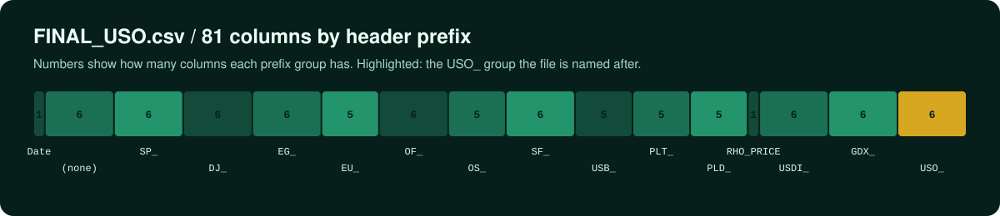

<div align="center">


<br>


</div>

Data files for a portfolio tracker project. The repository currently holds a single archive,
`archive_6.zip`, which contains one CSV file, `FINAL_USO.csv`: one row per trading day from
2011-12-15 to 2018-12-31, with daily price fields for a set of instruments side by side.


## Contents

| File | Inside | Size | Shape |
| --- | --- | --- | --- |
| `archive_6.zip` | `FINAL_USO.csv` | ~1.0 MB uncompressed | 1,718 rows x 81 columns, plus a header row |

Facts about `FINAL_USO.csv`:

- Comma-separated, one header row, no empty cells.
- `Date` is in `YYYY-MM-DD` format, sorted ascending, one row per date (1,718 unique dates).
- All other columns are numeric.
- Columns ending in `_Trend` hold only `0` or `1`.


## Columns



The header groups columns by prefix. The prefixes are reproduced exactly as they appear in the
file; the repository does not document what instrument each prefix refers to.

| Prefix | Columns |
| --- | --- |
| (none) | `Date`, `Open`, `High`, `Low`, `Close`, `Adj Close`, `Volume` |
| `SP_` | `SP_open`, `SP_high`, `SP_low`, `SP_close`, `SP_Ajclose`, `SP_volume` |
| `DJ_` | `DJ_open`, `DJ_high`, `DJ_low`, `DJ_close`, `DJ_Ajclose`, `DJ_volume` |
| `EG_` | `EG_open`, `EG_high`, `EG_low`, `EG_close`, `EG_Ajclose`, `EG_volume` |
| `EU_` | `EU_Price`, `EU_open`, `EU_high`, `EU_low`, `EU_Trend` |
| `OF_` | `OF_Price`, `OF_Open`, `OF_High`, `OF_Low`, `OF_Volume`, `OF_Trend` |
| `OS_` | `OS_Price`, `OS_Open`, `OS_High`, `OS_Low`, `OS_Trend` |
| `SF_` | `SF_Price`, `SF_Open`, `SF_High`, `SF_Low`, `SF_Volume`, `SF_Trend` |
| `USB_` | `USB_Price`, `USB_Open`, `USB_High`, `USB_Low`, `USB_Trend` |
| `PLT_` | `PLT_Price`, `PLT_Open`, `PLT_High`, `PLT_Low`, `PLT_Trend` |
| `PLD_` | `PLD_Price`, `PLD_Open`, `PLD_High`, `PLD_Low`, `PLD_Trend` |
| `RHO_` | `RHO_PRICE` |
| `USDI_` | `USDI_Price`, `USDI_Open`, `USDI_High`, `USDI_Low`, `USDI_Volume`, `USDI_Trend` |
| `GDX_` | `GDX_Open`, `GDX_High`, `GDX_Low`, `GDX_Close`, `GDX_Adj Close`, `GDX_Volume` |
| `USO_` | `USO_Open`, `USO_High`, `USO_Low`, `USO_Close`, `USO_Adj Close`, `USO_Volume` |

Note that the header spelling is not uniform (for example `SP_Ajclose` vs `GDX_Adj Close`, and
`open` vs `Open`), so match column names exactly when loading the file.


## Usage

```bash
git clone https://github.com/kaps10000/portfolio-tracker-datasets.git
cd portfolio-tracker-datasets
unzip archive_6.zip
```

Loading it in Python with pandas, for example:

```python
import pandas as pd

df = pd.read_csv("archive_6.zip", parse_dates=["Date"])  # pandas reads a single-file ZIP directly
print(df.shape)  # (1718, 81)
```

## Notes

- The repository does not state where the data was collected from or what licence it is under.
  Check the original source before redistributing it.
